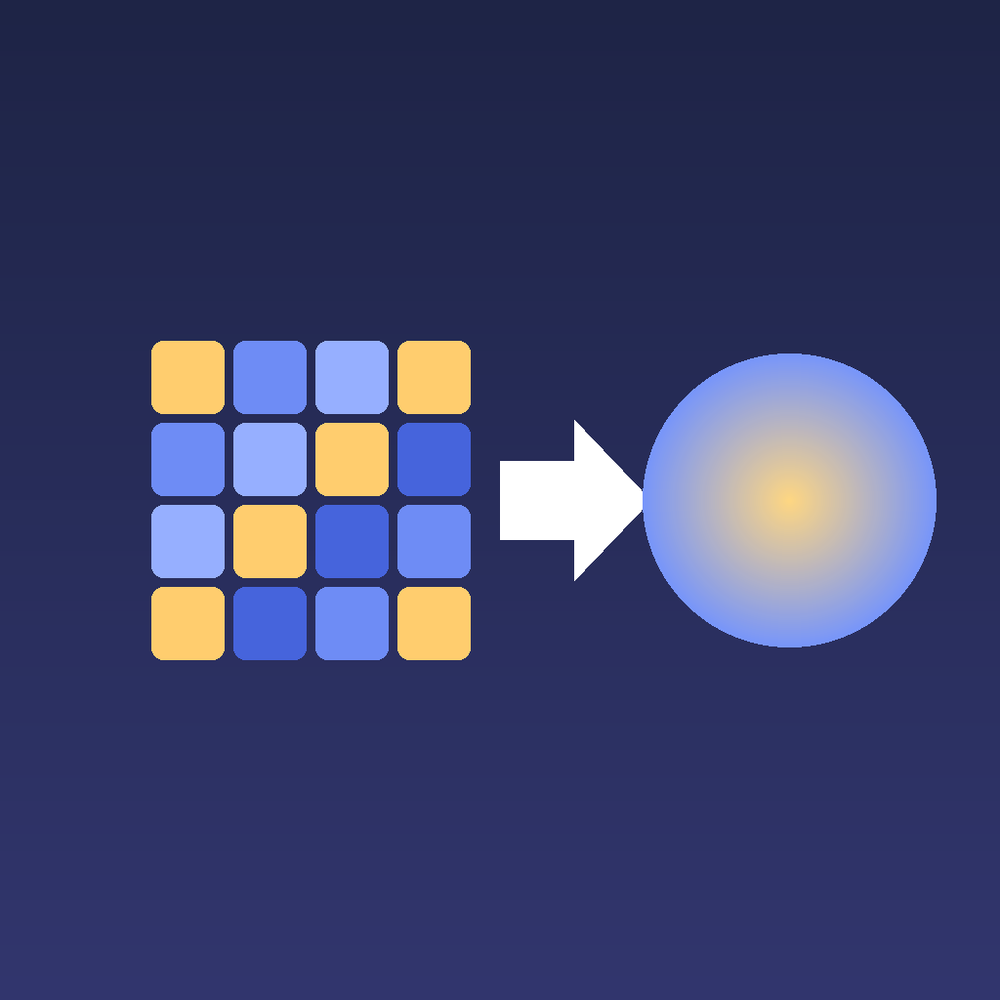

  

<h1 align="center">Texel</h1>

  <b>Small photo in. Stunning detail out.</b> 
  On-device AI image upscaler for Mac and Windows.

  <a href="https://github.com/Measupra/Texel/releases/latest"><b>⬇ Download for Mac</b></a>
  &nbsp;·&nbsp;
  <a href="https://github.com/Measupra/Texel/releases/latest"><b>⬇ Download for Windows</b></a>

Texel enlarges your photos up to **8×**, or cleans them up at the same size, with AI that runs entirely on your computer. No uploads, no accounts, no tracking.

## Install

### Mac

1. Download **Texel.zip** from the [latest release](https://github.com/Measupra/Texel/releases/latest).
2. Double-click it to unzip, and drag **Texel** into your **Applications** folder.
3. Open Texel.

If macOS says it can't verify Texel, go to **System Settings › Privacy & Security**, scroll down, click **Open Anyway** next to the message about Texel, and confirm. You only need to do this once.

Needs **macOS 14 Sonoma or later**. Works on Apple Silicon and Intel Macs.

### Windows

1. Download **Texel-Windows-1.0.0.zip** from the [latest release](https://github.com/Measupra/Texel/releases/latest).
2. Right-click it, choose **Extract All…**, and open the folder.
3. Double-click **Texel.exe**.

If Windows says "Windows protected your PC", click **More info**, then **Run anyway**. You only need to do this once.

Needs **Windows 10 or 11** (64-bit). A graphics card that supports DirectX 12 makes the AI much faster.

### iPhone and iPad

Texel also runs on iPhone and iPad, but there's no download for it yet: it has to be built and installed from this project with Xcode on a Mac.

## How to use

1. Open an image, drag one onto the window, or paste one.
2. Click **Auto Fix**: Texel looks at the photo, works out what's wrong with it and picks the best settings for you.

   Or choose them yourself:
   - **Size:** **1×** keeps the size and just makes the image cleaner and sharper; **2× to 8×** enlarge it.
   - **Mode:** **AI** for the best results (**Photo**, **General** for speed, or **Anime** for drawings), or **Classic** for fast upscaling without AI.
3. Click **Upscale**.
4. Drag the divider to compare before and after. Scroll to zoom in.
5. Fine-tune the result. The sliders update instantly, without running the AI again.
6. Save it as PNG, JPEG, HEIC (Mac) or WebP (Windows).

## Features

- **AI upscaling** with three Real-ESRGAN models, running on your computer's graphics chip.
- **Auto Fix** detects blur, grain, JPEG blocks, pixelation, faces, and dark or dull lighting, then sets everything to suit. It goes gently on clean photos, so they keep their look.
- **Face restoration** redraws blurry faces with a dedicated face AI, with a strength slider so people still look like themselves.
- **Colour & light** automatically fixes exposure, contrast and colour, and adds clarity to texture like trees, hair and fabric.
- **Finishing sliders:**
  - **AI** blends the AI result with a plain enlargement, for a more natural look.
  - **Detail** adds back the original's fine texture.
  - **Smooth** evens out noise and blockiness.
  - **Sharp** sharpens edges.
- **Pixelated images** are spotted and rebuilt from their real resolution instead of being enlarged block by block.
- **Classic mode** offers fast GPU upscaling without AI (AMD FidelityFX Super Resolution 1, detail refinement and sharpening).
- **Before/after compare** with a draggable divider, zoom and pan.
- **Private:** everything happens on your computer.

## Credits

- The upscaling models are converted from [Real-ESRGAN](https://github.com/xinntao/Real-ESRGAN) by Xintao Wang et al. (BSD 3-Clause License).
- Face restoration uses [GFPGAN](https://github.com/TencentARC/GFPGAN) v1.4 by Xintao Wang et al. (Apache License 2.0).
- On Windows, faces are found with [YuNet](https://github.com/opencv/opencv_zoo) by Shiqi Yu (MIT License).
- Classic mode includes a port of AMD FidelityFX Super Resolution 1.

The full licences are in the `Models` and `Windows/app/licenses` folders.
